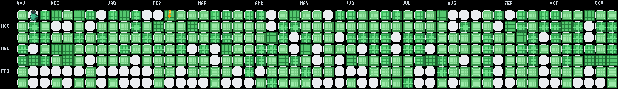

# contrib-blaster

**Your GitHub contribution graph, but it's a Bomberman level.**

[](https://github.com/iamRooney/contrib-blaster/actions/workflows/test.yml)
[](./LICENSE)

<!--
  NOTE: this is the current real output — real pixel-art entities, matching
  the new animation pack. Swap this file once you're ready to commit it.
-->


A GitHub Action that reads your real contribution graph and plays it back as a pixel-art animation — your busiest days get bombed first. Drop the output gif in your profile README and it updates itself daily. Original artwork, no fake commits, just your actual activity rendered as a tiny game.

```yaml
- uses: iamRooney/contrib-blaster@v1
  with:
    github-token: ${{ secrets.GITHUB_TOKEN }}
```

```markdown

```

That's the whole setup — see [Usage](#usage) below for the full workflow file.

> **Currently available:** the simulation engine is real and tested, and **sprites are now real pixel art**! The `bomber` animation pack is significantly enhanced with detailed graphics for the player, crates, bombs, explosions, and structural pillars. This is a major upgrade from the previous flat-rectangle rendering. If you want a second pack (Snake? Space Invaders?) or have suggestions for new artwork, see [Contributing](#contributing).

## Usage

```yaml
name: Update contribution animation
on:
  schedule:
    - cron: "0 0 * * *"
  workflow_dispatch:

jobs:
  animate:
    runs-on: ubuntu-latest
    steps:
      - uses: actions/checkout@v4
      - uses: iamRooney/contrib-blaster@v1
        with:
          animation: bomber
          output: gif
          github-token: ${{ secrets.GITHUB_TOKEN }}
      - uses: stefanzweifel/git-auto-commit-action@v5
        with:
          commit_message: "chore: update contribution animation"
          file_pattern: "output/*.gif"
```

Then embed the result in your profile README:

```markdown

```

Use `gif` or `webp` for README embedding, not `mp4` — GitHub only makes video embeddable when it's manually dragged into the web editor, which a GitHub Action can't do. `mp4` output is there for cases where you're hosting the file elsewhere.

## Inputs

| Input | Default | Description |
|---|---|---|
| `animation` | `bomber` | Which animation pack to run |
| `output` | `gif` | Output format: `gif`, `webp`, or `mp4` |
| `output-path` | `./output/contrib-animation.gif` | Where to write the file |
| `fps` | `24` | Output frame rate |
| `login` | repo owner | GitHub username whose contributions to animate |
| `github-token` | *(required)* | Needs `read:user` scope; the default workflow `GITHUB_TOKEN` works for a user's own public contributions |

<details>
<summary><strong>Requirements</strong></summary>

- `webp` and `mp4` output require `ffmpeg` on the runner's PATH. GitHub's `ubuntu-latest` hosted runners ship it preinstalled; on a self-hosted runner either install `ffmpeg` yourself or use `output: gif` (pure JS, no external binary).
- Private-repo contributions only count toward the animation if your GitHub profile has "Include private contributions" enabled — that's a GitHub account setting, not something this Action can override.

</details>

<details>
<summary><strong>Current status — what's real vs. not yet</strong></summary>

**Working:**
- Full simulation engine (tile map generation, pathfinding, target-priority bombing, loop/reset)
- Real GitHub GraphQL contribution fetch
- GIF, WebP, and MP4 output — all three verified against a full realistic 53-week contribution grid
- **Real pixel art sprites** for all entities: Player, Crates (Weak/Strong/Reinforced/Metal), Bombs, Explosions, and Powerups

**Not yet done:**
- **Only the `bomber` animation pack exists**; the engine supports others (Snake, Space Invaders, etc.) but none are written yet. Help us expand the library!

</details>

## Architecture

The animation engine is generic — `bomber` is a plugin, not baked into the core. Adding a new pack (Snake, Space Shooter, etc.) means implementing the `Scene` interface in `src/animations/<name>/`; nothing in `src/engine/` needs to change.

The new pixel-art sprites are generated programmatically from scripts/design/gen-all-sprites.mjs, ensuring perfect symmetry and consistency across all entity types.

## Screenshots

See the [contrib-blaster repository](https://github.com/iamRooney/contrib-blaster) for generated demo animations and output samples.

## Contributing

Contributions are welcome! To add a new animation pack:

1. Create a new directory in `src/animations/<name>/`
2. Implement the `Scene` interface
3. Register your animation pack in `src/animations/<name>/index.ts`
4. Add your pack's sprites (see `scripts/design/gen-all-sprites.mjs` as a template)

For sprite art suggestions, contact the maintainer or open an issue.

## License

MIT
